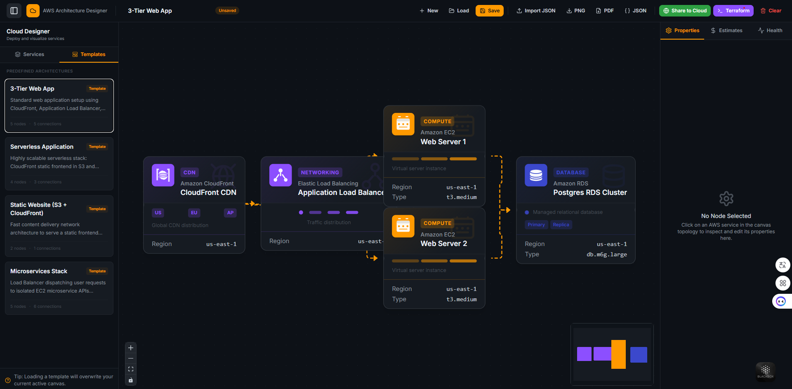
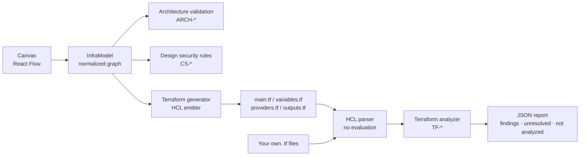

# AWS Cloud Designer

[](https://github.com/tanakaseidy3103/aws-cloud-designer/actions/workflows/ci.yml)
[](#日本語-japanese-overview)

Design an AWS architecture on a canvas, check it for design and security problems, estimate its
monthly cost, and export Terraform that passes `terraform fmt` and `terraform validate`.
It includes a static security analyzer that also scans Terraform you wrote yourself.



Built with Next.js 15, React 19, TypeScript (strict), React Flow and Tailwind CSS v4.

---

## What it does

| Area | What you get | Where |
|---|---|---|
| Visual design | Drag EC2, S3, RDS, Lambda, ALB and CloudFront onto a canvas and connect them | `components/` |
| Architecture validation | 23 rules (ARCH-001…) for wiring mistakes such as an ALB with no targets or an isolated database, plus a 0–100 health score | `lib/validation.ts` |
| Design security checks | 18 rules (CS-*) on the diagram: public buckets, open SSH, unencrypted storage, IMDSv1, missing logs | `lib/security/` |
| Terraform generation | A dedicated VPC with public and private subnets, security groups as separate rules, RDS passwords in Secrets Manager, private S3 with TLS-only policy, CloudFront with OAC | `lib/iac/` |
| Terraform security analyzer | 24 rules (TF-*) over any `.tf` directory, with file, line, evidence, risk and remediation for each finding | `lib/security/terraform/` |
| Cost estimate | Approximate monthly cost that updates as you edit | `lib/cost-estimation.ts` |
| Templates | 3-tier web app, serverless API, static site, microservices, and a deliberately insecure "SSH open to the internet" scenario | `lib/templates.ts` |
| Share | Optional PNG upload to your own private S3 bucket, returned as a presigned URL | `app/api/upload/` |

## How it works



- **InfraModel** (`lib/infra/`): the canvas graph turned into resolved resource configs, unique
  Terraform names, and typed relationships (CDN origin, load balancer target, database client,
  storage access). The validation, security rules and generator all read this one model.
- **HCL parser** (`lib/hcl-parser/`): a deterministic parser for the Terraform subset that real
  configurations use. It keeps expressions such as `var.x` as raw text with their references and
  never invents values. Every block and attribute carries its file and line. Unsupported syntax
  produces an explicit diagnostic. Why it is in-house and what it cannot do:
  [ADR 0001](docs/architecture/adr/0001-terraform-hcl-parser.md).
- **Analyzer**: each check is known (finding or pass), absent (provider default, stated in the
  evidence) or unresolved (depends on a variable). Unresolved checks are reported, never counted
  as secure. A report is `clean` only when every applicable check was decided.

## Scan your own Terraform

```bash
npm run scan:terraform -- path/to/terraform --out report.json --fail-on high
```

Example output on the bundled insecure fixture:

```text
[CRITICAL] TF-IAM-001 iam.tf:4 data.aws_iam_policy_document.admin_like — IAM policy allows Action "*"
[CRITICAL] TF-S3-004 s3.tf:17 aws_s3_bucket_policy.public_site — S3 bucket policy allows anonymous access
[HIGH] TF-SG-001 network.tf:10 aws_security_group.bastion — SSH (22) open to the internet
[HIGH] TF-RDS-001 rds.tf:8 aws_db_instance.legacy — Database publicly accessible
[MEDIUM] TF-EC2-001 ec2.tf:8 aws_instance.imds_v1 — IMDSv2 not enforced
[UNRESOLVED] TF-RDS-001 main.tf:35 aws_db_instance.app.publicly_accessible = var.db_public
```

Exit codes: `0` clean, `1` findings at or above `--fail-on`, `2` incomplete analysis, `3` usage
error. The scanner only reads files. It never runs Terraform and never contacts AWS.

## Run locally

Requires Node.js 20+.

```bash
npm install
npm run dev        # http://localhost:3000
```

No AWS account is needed to design, validate, estimate and export. The share feature is
off unless you set `AWS_S3_BUCKET_NAME` (see `.env.example`). Each share is a small, billable S3
request.

## Tests

```bash
npm run lint
npm run typecheck
npx vitest run --project unit     # 270+ unit tests, no network
npm run test:terraform            # real terraform fmt + init -backend=false + validate
```

The Terraform suite needs the `terraform` binary (or `TERRAFORM_BIN`). It removes every `AWS_*`
variable before calling Terraform and runs only `fmt`, `init -backend=false` and `validate`.
No `plan`, no `apply`, no credentials. CI runs all of the above on every push
([workflow](.github/workflows/ci.yml)).

## Safety rules this project follows

- The app never runs `terraform plan` or `terraform apply`, and never creates AWS resources.
- CI uses no AWS credentials and deploys nothing.
- Generated Terraform defaults to the cheaper option where there is a choice, for example no NAT
  Gateway unless you enable it. Review the cost estimate before deploying anything.
- Known open issue: the app has no user authentication. Do not expose the share route publicly
  with real credentials. See the [security review](docs/security/security-review.md).

## Project status

| Phase | Scope | Status |
|---|---|---|
| 0 | Repository audit | Done: [audit](docs/development/phase-0-audit.md) |
| 1 | Correct model, Terraform generator, validation, design rules, Terraform security analyzer | Done |
| 1 | Upload route hardening | Done (authentication still open) |
| 1 | Show analyzer findings in the UI | Not started |
| 2 | In-app Terraform pipeline (fmt/validate with timeouts, concurrency limit, redaction) | In progress, not merged |
| 3 | CI/CD | Basic CI done; dependency scanning not yet |
| 4–8 | Local cloud lab, operations graph, auth lab, read-only existing-EC2 view, local AI assistant | Planned |

## Documentation

- [Architecture decision: HCL parser](docs/architecture/adr/0001-terraform-hcl-parser.md)
- [Security review](docs/security/security-review.md)
- [Phase 0 audit](docs/development/phase-0-audit.md)
- [Original project audit](docs/PROJECT_AUDIT.md)

---

## 日本語 (Japanese overview)

キャンバス上でAWS構成図を作成し、設計ミスとセキュリティ上の問題を検出し、月額コストを概算し、
`terraform fmt` と `terraform validate` を通過するTerraformコードを出力するWebアプリです。

### 主な機能

- **ビジュアル設計**: EC2、S3、RDS、Lambda、ALB、CloudFrontを配置して接続
- **構成検証**: 23個のルール（ARCH-*）で接続ミスなどを検出し、0〜100のヘルススコアを表示
- **設計時のセキュリティチェック**: 18個のルール（CS-*）。公開S3、SSHの全開放、暗号化なし、IMDSv1など
- **Terraform生成**: 専用VPC（パブリック／プライベートサブネット）、RDSパスワードはSecrets Managerで管理、S3は非公開＋TLS必須
- **Terraformセキュリティ解析**: 24個のルール（TF-*）。手書きの `.tf` も解析でき、各指摘にファイル・行番号・根拠・リスク・修正方法を付与
- **コスト概算**: 編集に合わせて月額費用を自動更新

### 技術的なポイント

- **自作HCLパーサー**: 変数や式を評価せず、元のテキストのまま保持します。値が変数に依存する場合は「判定不能（unresolved）」として報告し、安全とは判定しません。設計判断は [ADR 0001](docs/architecture/adr/0001-terraform-hcl-parser.md)（英語）にまとめています。
- **テスト**: ユニットテスト270件以上、実際のTerraformバイナリを使った `fmt` / `validate` の統合テスト。
- **安全性**: `terraform plan` / `apply` は実行しません。AWSリソースを作成せず、CIでもAWS認証情報を使いません。

### 既知の制限

- ユーザー認証はまだありません（共有機能を公開環境で使わないでください）。
- パーサーは `module` の中身、`dynamic` ブロック、`.tf.json` を解析しません。
- 解析結果はまだUIに表示されず、CLIとJSONレポートのみです。

### 起動方法

```bash
npm install
npm run dev   # http://localhost:3000
```
